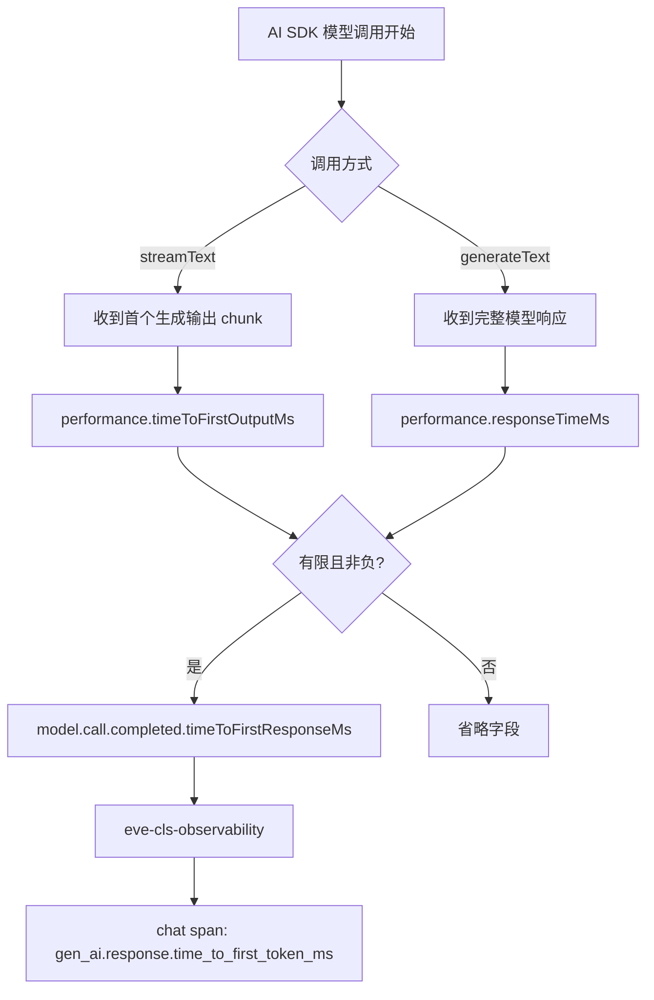
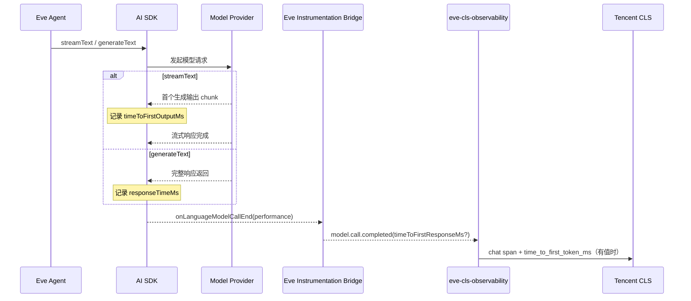

# Chat 首响应耗时接入指南

本指南说明如何让 `eve-cls-observability` 在 chat span 中上报：

```text
gen_ai.response.time_to_first_token_ms
```

该能力是**可选增强项**。不需要该指标，或不希望修改 Eve 的客户，无需做任何操作；插件会继续上报完整调用链、总耗时、Token、工具调用等其他数据，并直接省略该字段，不会写入错误的 `0`。

## 1. 指标口径

插件内部统一接收 Eve 事件字段：

```ts
timeToFirstResponseMs?: number
```

数据来源取决于 AI SDK 调用方式：

| AI SDK 调用 | 数据源 | 口径 |
|---|---|---|
| 流式 `ai.streamText` | `performance.timeToFirstOutputMs` | Provider 调用开始，到首个生成输出 chunk 到达 |
| 非流式 `ai.generateText` | `performance.responseTimeMs` | Provider 调用开始，到完整响应返回 |
| 未知 operation、空流或无有效值 | 不上报 | 插件省略字段 |

首个生成输出 chunk 可能是文本、推理、文件、工具参数增量或 tool call。因此 CLS 字段虽然名为 `time_to_first_token_ms`，实际采用跨模型更稳定的“首个模型输出”口径，并不保证是首个可见文本 Token。

只接受有限且非负的数值；`undefined`、负数、`NaN`、`Infinity` 都会被忽略。

## 2. 取值逻辑图



时序上，AI SDK 在首个输出到达时记录时间，但 Eve 在 `model.call.completed` 时把已记录的数值交给插件：



## 3. 是否需要修改 Eve

### 不需要该指标

无需修改 Eve。继续使用现有版本即可：

```text
model.call.completed 不含 timeToFirstResponseMs
        ↓
插件正常结束 chat span
        ↓
省略 gen_ai.response.time_to_first_token_ms
```

其他观测字段不受影响。这也是插件对旧 Eve 的默认兼容行为。

### 需要该指标

优先升级到已经正式提供 `model.call.completed.timeToFirstResponseMs` 的 Eve 版本。如果当前 Eve 版本尚未提供该字段，可按下一节维护一个临时 fork。不要在生产环境直接手改 `node_modules`；源码补丁应进入客户自己的 Eve fork，并经过构建和测试后以 tarball 或内部制品发布。

## 4. 修改 Eve 源码

以下路径以 Eve 仓库根目录为基准。

### 第一步：扩展 lifecycle 事件

修改：

```text
packages/eve/src/instrumentation/lifecycle.ts
```

在 `InstrumentationModelCallCompletedEvent` 中增加可选字段：

```ts
export interface InstrumentationModelCallCompletedEvent {
  readonly type: "model.call.completed";
  readonly content?: readonly InstrumentationContentPart[];
  readonly finishReason: string;
  readonly idempotencyKey: string;
  readonly responseModelId?: string;
  readonly responseId?: string;
  /** Provider start to first streamed output or complete non-streamed response, in ms. */
  readonly timeToFirstResponseMs?: number;
  readonly scope: InstrumentationAttemptScope;
  readonly usage: InstrumentationUsage;
}
```

字段必须保持可选，以保证现有 instrumentation provider 和缺少性能数据的模型调用继续兼容。

### 第二步：在 AI SDK Bridge 中透传

修改：

```text
packages/eve/src/instrumentation/ai-sdk-hook-bridge.ts
```

在 `toModelCallCompleted()` 中选择并校验性能值：

```ts
function toModelCallCompleted(
  state: AttemptState,
  idempotencyKey: string,
  source: TelemetryEvent<"onLanguageModelCallEnd">,
): InstrumentationModelCallCompletedEvent {
  const timeToFirstOutputMs = source.performance?.timeToFirstOutputMs;
  const responseTimeMs = source.performance?.responseTimeMs;
  const firstResponseCandidate =
    state.operation?.operationId === "ai.streamText"
      ? timeToFirstOutputMs
      : state.operation?.operationId === "ai.generateText"
        ? responseTimeMs
        : undefined;
  const timeToFirstResponseMs =
    typeof firstResponseCandidate === "number" &&
    Number.isFinite(firstResponseCandidate) &&
    firstResponseCandidate >= 0
      ? firstResponseCandidate
      : undefined;

  return Object.freeze({
    content: state.capturesOutputs ? toContentParts(source.content) : undefined,
    finishReason: source.finishReason,
    idempotencyKey,
    responseModelId: source.modelId,
    responseId: source.responseId,
    scope: state.scope,
    type: "model.call.completed",
    usage: toUsage(source.usage),
    ...(timeToFirstResponseMs !== undefined ? { timeToFirstResponseMs } : {}),
  });
}
```

不要在插件中用 `Date.now()` 重新计算。AI SDK 的计时位置最接近 Provider，可以避免 Eve 调度、事件派发和插件处理时间污染指标。

也不要对未知 operation 回退到 `responseTimeMs`：未知调用可能仍是流式调用，把完整响应耗时当作首响应耗时会系统性放大指标。

### 第三步：补齐 Eve 测试

修改：

```text
packages/eve/src/instrumentation/ai-sdk-hook-bridge.test.ts
packages/eve/src/instrumentation/lifecycle.test.ts
```

至少覆盖：

1. `ai.streamText` 使用 `timeToFirstOutputMs`，不使用更大的 `responseTimeMs`；
2. `ai.generateText` 在没有 `timeToFirstOutputMs` 时使用 `responseTimeMs`；
3. tool-call-only 流式响应仍有首输出耗时；
4. `recordOutputs=false` 时正文被移除，但性能字段保留；
5. 缺少 `onStart`、未知 operation、空流时不误报；
6. `undefined`、负数、`NaN`、`Infinity` 被忽略；
7. 重复 terminal callback 仍只发布一次。

建议验证命令：

```bash
cd packages/eve
pnpm run typecheck
pnpm run test:unit
```

### 第四步：构建并交付客户 fork

Eve 使用 pnpm workspace catalog，不能直接在 `packages/eve` 中执行普通 `npm pack`：原始 tarball 会保留 `catalog:`，npm 安装时会报 `EUNSUPPORTEDPROTOCOL`。应使用仓库自带的 `runPack()` helper，把 catalog 引用改写为具体版本。

在 Eve 仓库根目录执行：

```bash
pnpm install
pnpm --filter eve build
mkdir -p artifacts
node --input-type=module - "$(pwd)/artifacts" <<'NODE'
import { runPack } from "./scripts/package-publish-report.mjs";
const result = await runPack("./packages/eve", process.argv[2]);
console.log(`created artifacts/${result.filename}`);
NODE
```

可先检查 tarball 中不再包含 `catalog:`：

```bash
tar -xOf artifacts/eve-<version>.tgz package/package.json | grep 'catalog:' && exit 1 || true
```

生成的 `artifacts/eve-<version>.tgz` 可作为 CI 制品安装：

```bash
npm install /path/to/eve-repo/artifacts/eve-<version>.tgz
```

生产环境建议把 fork 发布到客户自己的制品仓库，并固定版本及 integrity。不要依赖开发机上的源码软链接。

## 5. 插件侧需要什么

安装支持该映射的插件版本后，不需要增加配置开关：

```bash
npm install eve-cls-observability@^0.3.0
```

插件读取可选字段并映射：

```text
model.call.completed.timeToFirstResponseMs
        ↓
gen_ai.response.time_to_first_token_ms
```

该性能字段不包含正文，因此不受以下配置影响：

```text
recordInputs
recordOutputs
recordReasoning
```

插件仍会校验数值；Eve 不提供字段时直接省略。

## 6. 验证结果

维护者已完成两类验证：

### 自动化测试

- Eve：流式、非流式、tool-call-only、未知 operation、隐私关闭、非法值和重复 terminal；
- 插件：有效值、缺失值、非法值、正文关闭、失败调用和 durable 恢复；
- 旧 Eve：插件可以加载和运行，缺失指标时不报错、不写 `0`。

### 真实模型端到端测试

2026-10-30，维护者使用真实 DeepSeek `deepseek-flash` 流式模型执行单轮、无工具 eval，并在 CLS 上传边界读取生成的 chat span。测试使用修改后的 Eve tarball 和插件 `0.3.0` tarball，结果为：

```text
Eval: 1 passed
Gates: 3 passed
Captured gen_ai.response.time_to_first_token_ms: 1144.842084 ms
```

该数值只证明 `AI SDK → Eve Bridge → 插件 → CLS chat span` 真实链路已打通，不是模型性能基准；它会随模型、地域、网络、输入长度和服务负载变化。验证过程中使用假 CLS 凭据，并只在进程内拦截官方 CLS 上传请求；模型请求仍发送给真实 Provider，测试 span 没有写入真实 CLS 主题。测试提示词不包含客户数据。

## 7. 验收检查表

- [ ] Eve 的 `model.call.completed` 类型包含可选 `timeToFirstResponseMs`；
- [ ] 流式调用取 `timeToFirstOutputMs`；
- [ ] 非流式 `generateText` 取 `responseTimeMs`；
- [ ] 未知/缺失/非法值不输出；
- [ ] `recordOutputs=false` 时指标仍存在；
- [ ] chat span 同时包含总耗时和首响应耗时；
- [ ] 不需要指标的旧 Eve 场景仍能正常运行；
- [ ] 生产依赖固定到经过测试的 Eve fork 或正式版本。
